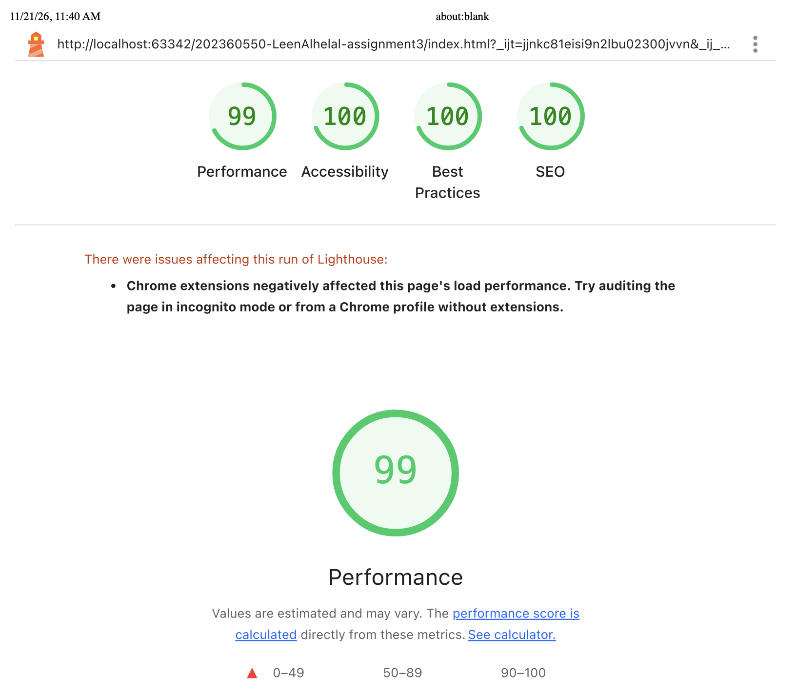

# Technical Documentation – Assignment 3

Portfolio of Leen Alhelal · plain HTML, CSS, and JavaScript (no frameworks, no build step).

---

## 1. Overview

| File | Purpose |
|------|---------|
| `index.html` | Page structure: header, hero, about, accessibility panel, projects, project pop-ups, contact form, footer |
| `css/styles.css` | All styling. Colours are CSS custom properties (variables), with separate values for light, dark, and high-contrast modes |
| `js/script.js` | All behaviour, split into commented sections (see section 3) |
| `assets/images/` | SVG illustrations for the project cards |

The script is loaded at the end of `<body>`, so all page elements exist before it runs.

---

## 2. API integration: Open-Meteo

### Why this API
| Requirement | Open-Meteo |
|---|---|
| Free | Yes, for non-commercial use |
| No API key | Yes. Important because this is a public repository with no backend, so any key would be visible to everyone |
| Works from the browser (CORS) | Yes |
| Licence | CC BY 4.0 → credited under the weather panel ("Weather data by Open-Meteo.com") |

I also considered Meteosource, but it requires an API key, which would be exposed in `script.js`.

### Request
Built with the URL builder on the official docs page (open-meteo.com/en/docs):

```
https://api.open-meteo.com/v1/forecast
  ?latitude=42.3584&longitude=-71.0598          (Boston)
  &current=temperature_2m,precipitation,weather_code,wind_speed_10m
  &timezone=America%2FNew_York
```

Only the four values the feature needs are requested, which keeps the response small.

### Response (fields used)
```json
"current": {
  "time": "2026-11-20T15:30",
  "interval": 900,
  "temperature_2m": 16.9,
  "precipitation": 0,
  "weather_code": 0,
  "wind_speed_10m": 11.7
}
```
- `temperature_2m`: air temperature 2 m above ground (°C)
- `wind_speed_10m`: wind speed 10 m above ground (km/h)
- `precipitation`: rain/snow over the last `interval` (900 s = 15 minutes), in mm
- `weather_code`: WMO weather code (e.g. 0 = clear sky, 61 = slight rain)

### Flow (`loadWeather()` in `script.js`)
1. Runs only when the Route Planner pop-up is opened, **not on page load**, so the API never slows down the first view of the page.
2. Skips the request if one is already running, or if the data is less than 15 minutes old (Open-Meteo's current data is in 15-minute steps, so fetching more often would return the same numbers).
3. `fetch()` → checks `response.ok` → `response.json()`.
4. Passes the data to `assessWalkingConditions()` and shows the result.
5. A `finally` block marks loading as finished, whether the request succeeded or failed.

### Error handling
- `fetch()` does **not** reject on HTTP errors such as 404 or 500, so the code checks `response.ok` and throws an error itself.
- Network failures and HTTP errors are both caught by `try/catch`. The visitor sees: *"Sorry, live weather isn't available right now. Please try again later."*
- The fetch time is only saved on success, so the next opening of the pop-up tries again.
- Tested by deliberately breaking the URL.

### Walking-condition rules (`assessWalkingConditions()`)
Rules are checked from most to least serious, and the first match wins:

| Order | Condition | Level |
|---|---|---|
| 1 | Freezing drizzle/rain (codes 56, 57, 66, 67), or temperature ≤ 0 °C with precipitation | Difficult |
| 2 | Snow (71, 73, 75, 77, 85, 86) | Difficult |
| 3 | Thunderstorm (code ≥ 95) | Difficult |
| 4 | Drizzle/rain (51–55, 61–65, 80–82) | Caution |
| 5 | Wind ≥ 40 km/h | Caution |
| 6 | Fog (45, 48) | Caution |
| — | Anything else (clear or cloudy, 0–3) | Good |

Weather codes come from the WMO table in the Open-Meteo documentation.
The status uses an icon **and** a text title, so it does not rely on colour alone.

---

## 3. JavaScript features

### 3.1 Project detail pop-ups
- Each "Learn more" button has `data-dialog="<id of its pop-up>"`. One loop handles all buttons, so no code is repeated per project.
- `dialog.showModal()` opens the native `<dialog>`, which provides for free: a backdrop, focus kept inside the pop-up, **Esc** to close, and focus returned to the button on close.
- Clicking outside closes it: the content sits inside `.dialog-inner`, so a click whose `event.target` is the `<dialog>` itself must be on the backdrop.

### 3.2 Contact form validation
- The form has `novalidate`, so the browser's own pop-up bubbles are replaced by clearer custom messages.
- One check function per field returns an error message, or `""` if valid:

| Field | Rules |
|---|---|
| Name | not empty → at least 2 characters → only letters (any language, `\p{L}`), spaces, `-` and `'` |
| Email | not empty → matches `something@something.xx` (simple typo check, not full email verification) |
| Message | not empty → 10 to 1000 characters (trimmed), with the current count shown in the error |

- `formFields` pairs each input with its check function, so all fields are handled by the same loops.
- **When fields are checked:**
    - when the visitor leaves a field (`blur`)
    - while typing in a field that already has an error (`input`), so the error disappears as soon as it is fixed
    - on submit, every field is checked, the number of errors is announced, and focus moves to the first invalid field
- **Accessibility:**
    - each input is linked to its error with `aria-describedby`
    - invalid fields get `aria-invalid="true"`, which screen readers announce and CSS uses for the red border
    - the form status uses `role="status"`
- **Limitation:** this is client-side validation only, for user experience. It can be bypassed, so a future backend must validate the same rules again.

### 3.3 Existing features (Assignments 1 & 2)
- **Theme toggle:** sets `data-theme` on `<html>`. The choice is saved in `localStorage` and falls back to the device preference (`prefers-color-scheme`).
- **Project filter:** shows or hides cards using `data-status` and announces the visible count.
- **Accessibility settings:** text size, line spacing, contrast, and width are applied through CSS variables and attributes, and saved in `localStorage`. Every `localStorage` call is wrapped in `try/catch`, because some browsers block storage.

---

## 4. State management

| State | Where it lives | Remembered after reload? |
|---|---|---|
| Theme (light/dark) | `localStorage` (`portfolio-theme`) | Yes |
| Accessibility settings | `localStorage` (`leen-portfolio-accessibility`) | Yes |
| Weather data age | `weatherFetchedAt` variable | No (fresh data is fetched on a new visit) |
| Weather request in progress | `weatherLoading` variable | No |
| Form field validity | `aria-invalid` attribute on each input | No |

---

## 5. Performance

### Lighthouse results (Chrome DevTools)
| Device | Performance | Accessibility | Best Practices | SEO |
|---|---|---|---|---|
| Mobile | 99 | 100 | 100 | 100 |
| Desktop | _fill in_ | _fill in_ | _fill in_ | _fill in_ |



Local Core Web Vitals (Performance panel): LCP 0.14 s, CLS 0, INP 128 ms.

### Why it is fast
- No frameworks or libraries: one CSS file and one JS file.
- The API is called only when the Route Planner pop-up opens, never during page load, and at most once every 15 minutes.
- Images are small SVGs with `width`, `height`, and `loading="lazy"`. This prevents layout shift (CLS = 0) and delays off-screen images.
- The script is placed at the end of `<body>`, so it doesn't block the page from appearing.
- Colours are stored once as CSS variables, so the theme modes don't repeat whole rule sets.
- Files were reorganised so only site files are tracked. The IDE's `.idea/` folder is excluded via `.gitignore`.

---

## 6. Accessibility summary
- Skip link, semantic landmarks (`header`, `nav`, `main`, `footer`), and labelled sections
- Visible keyboard focus (`:focus-visible`)
- Live regions for status messages (filter count, accessibility panel, weather, form)
- Native `<dialog>` for keyboard-friendly pop-ups
- Field-level error messages linked with `aria-describedby`
- Status shown with icon + text, never colour alone
- Light, dark, and high-contrast modes, plus adjustable text size and spacing
- Reduced motion respected (`prefers-reduced-motion`)

---

## 7. Browser compatibility
Built on standard features supported by current Chrome, Edge, Firefox, and Safari: `fetch`, `async/await`, `<dialog>`, CSS custom properties, Grid/Flexbox, and Unicode regex (`\p{L}`).
Tested in: _list the browsers/devices you tested (e.g. Chrome on macOS, Safari on iPhone)_.

---

## 8. Known limitations and future work
- The contact form does not send messages (no backend). A backend would also need its own validation.
- Walking-condition rules are a simplified demo and are not a safety tool.
- Weather is shown for Boston only. A future version could let visitors choose a city.